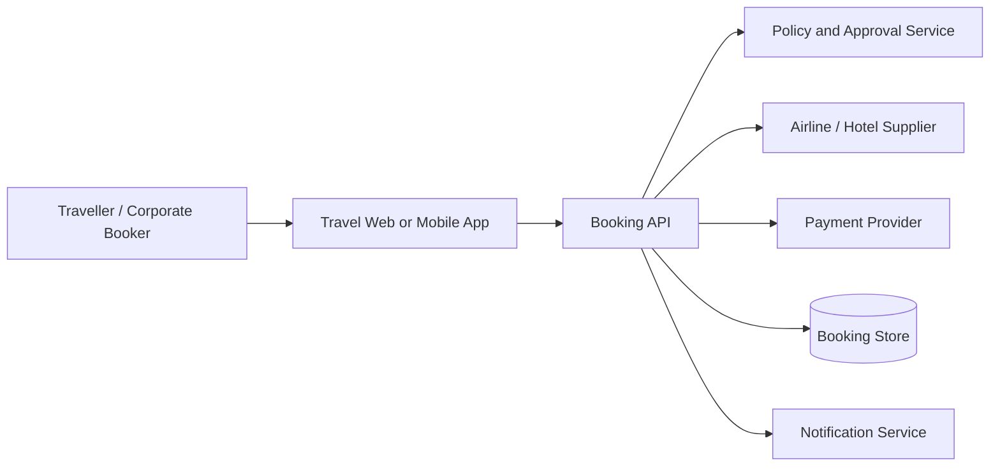

**Technical Product Management Lab** · [Home](../README.md) · [Previous: API testing](../03-postman/README.md) · [Next: Integrations →](../05-integrations/README.md)

---

# 04 — System Design for Product Managers

A PM should be able to explain the actors, systems, data boundaries, dependencies and failure paths of a feature. Engineering owns implementation choices; product helps ensure the design solves the right problem and meets user, business and operational needs.

## Example: travel booking context


## Example: create booking sequence
```mermaid
sequenceDiagram
  actor User
  participant App
  participant API as Booking API
  participant Supplier
  participant DB as Booking Store
  User->>App: Confirm selected offer
  App->>API: POST /bookings + idempotency key
  API->>Supplier: Revalidate and book
  alt Supplier confirms
    Supplier-->>API: Confirmation reference
    API->>DB: Save CONFIRMED
    API-->>App: 201 Booking confirmed
  else Supplier rejects
    Supplier-->>API: Rejection
    API->>DB: Save FAILED
    API-->>App: Booking unavailable
  else Supplier response times out
    Supplier--xAPI: No timely response
    API->>DB: Save PENDING_RECONCILIATION
    API-->>App: Status pending; do not retry blindly
  end
```

## Product questions
- Which system is the source of truth?
- What data crosses each boundary?
- What is synchronous versus asynchronous?
- What is the expected latency and availability?
- What happens when one dependency is unavailable?
- How do we prevent duplicate operations?
- How are events, logs and support traces correlated?

## Non-functional requirement examples
These are illustrative starting points, not universal targets. Agree measurable thresholds with engineering and business owners:
- Performance: define a percentile target for key journey response time.
- Availability: define service-level objective and maintenance expectations.
- Security: authentication, authorisation, encryption and auditability.
- Scalability: forecast peak traffic and concurrency.
- Reliability: retries, idempotency, recovery and reconciliation.
- Observability: metrics, logs, traces and actionable alerts.

Next: [Integration patterns](../05-integrations/README.md).