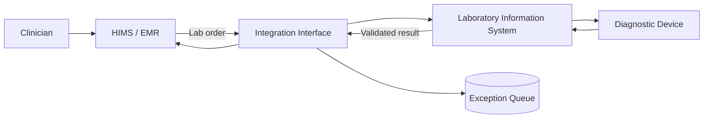

[← All case studies](README.md) · [Repository home](../README.md)

# Case Study — Healthcare Laboratory Integration

<small>Illustrative reconstruction using synthetic patient, order and result data.</small>

## Context
A Hospital Information System (HIS/HIMS) may exchange laboratory orders and results with a Laboratory Information System (LIS) and diagnostic devices. Interoperability depends on reliable patient/specimen identification, message mapping and exception handling.

## User problem
Clinicians need laboratory results associated with the correct patient and order. Delayed, duplicated or mismatched messages can disrupt clinical workflows and require investigation.

## Product objective
Improve traceability of the order-to-result workflow and make integration exceptions visible to authorised operational users.

## High-level flow

## Requirements to validate
- Map patient, encounter, order and specimen identifiers consistently.
- Validate message structure and required fields before processing.
- Detect duplicate messages and avoid duplicate result creation.
- Preserve result status, units, reference ranges and timestamps.
- Route unmatched or invalid messages to an authorised exception queue.
- Maintain an audit trail of message receipt, transformation and delivery.
- Restrict access to patient information according to role and policy.

## Example acceptance criteria
1. A valid lab order is transmitted with the agreed patient and specimen identifiers.
2. A result is linked only when patient and order matching rules pass.
3. A duplicate inbound result does not create a second result record.
4. An unmatched result is quarantined for authorised review rather than silently discarded.
5. Failed delivery is observable and can be retried under defined rules.
6. Every manual correction is auditable.

## Interoperability considerations
HL7 v2 and ASTM may appear in healthcare integration environments, depending on the system and device. The exact message profile, segments, code sets, acknowledgement behaviour and device protocol must be confirmed with the integration and clinical teams; this example does not prescribe a universal implementation.

## Candidate measures
- Order-to-result turnaround time.
- Message delivery success rate.
- Unmatched patient/order rate.
- Duplicate result rate.
- Exception resolution time.
- Manual intervention volume.

These are proposed measures, not claimed measured outcomes.

## Product and safety considerations
Clinical data integrity takes priority over silent auto-correction. Define who can resolve exceptions, how corrections are audited, how critical results are handled, and what downtime procedure applies. Validate clinical workflow and regulatory requirements with qualified stakeholders.

## Portfolio note
The healthcare domain aligns with the types of HIMS, EMR, LIS and device-integration work described in my professional background. The workflow, requirements and diagrams here are reconstructed, synthetic portfolio examples and not a production hospital interface specification.