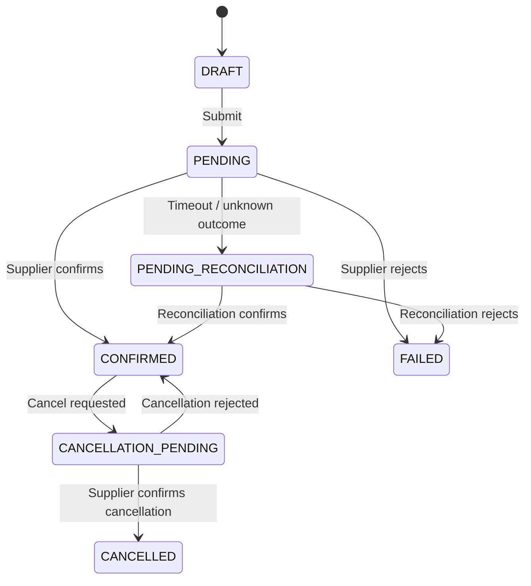

[← All case studies](README.md) · [Repository home](../README.md)

# Case Study — Travel Booking API Integration

<small>Illustrative reconstruction using synthetic workflows and example identifiers.</small>

## Context
A travel platform connects a booking experience to external airline or hotel suppliers. Search results can become stale as availability and prices change. The booking journey therefore needs a deliberate revalidation and confirmation process.

## User problem
A traveller selects an offer but may encounter a changed price, unavailable inventory or delayed supplier response during booking.

## Product objective
Make the booking journey predictable, transparent and recoverable when supplier responses are inconsistent or delayed.

## Actors and systems
- Traveller or corporate travel arranger.
- Web/mobile booking experience.
- Booking orchestration API.
- Policy and approval service (where applicable).
- Airline/hotel supplier API.
- Booking database and notification service.

## Proposed journey
1. User selects an offer from search results.
2. Platform revalidates price and availability.
3. User reviews any material change and confirms.
4. Platform submits a booking request with an idempotency key.
5. Supplier response is mapped to a platform booking state.
6. User receives confirmation or a clear pending/failed outcome.

## State model

## Requirements
- Revalidate price and availability before final booking.
- Present material price changes before user confirmation.
- Use an idempotency key for booking submission.
- Store supplier reference and platform booking ID separately.
- Represent uncertain outcomes as pending reconciliation.
- Provide a status lookup and auditable state changes.

## Key acceptance scenarios
- Price changed: user must accept the updated total before booking.
- Inventory unavailable: do not create a confirmed booking; present alternatives if available.
- Supplier timeout: show pending status and initiate reconciliation.
- Duplicate submit: return the original operation outcome.
- Cancellation rejected: retain confirmed status and communicate the reason safely.

## Candidate product measures
- Search-to-booking conversion.
- Booking completion and supplier rejection rates.
- Price-change frequency and abandonment.
- Duplicate booking rate.
- Percentage of pending bookings reconciled within agreed target.
- Booking support contacts per 1,000 bookings.

These are proposed instrumentation measures, not claimed measured outcomes.

## Technical questions for engineering
- Does supplier booking support idempotency or reference-based lookup?
- Which state transitions are legal?
- How are late supplier responses handled?
- What is the reconciliation schedule and escalation path?
- How are supplier-specific errors mapped to user-safe messages?
- What audit and retention rules apply?

## Portfolio note
The domain context reflects the kinds of travel technology workflows described in my professional background. The specific API contract, state model, requirements and diagrams in this document are reconstructed examples, not representations of a particular employer's production implementation.