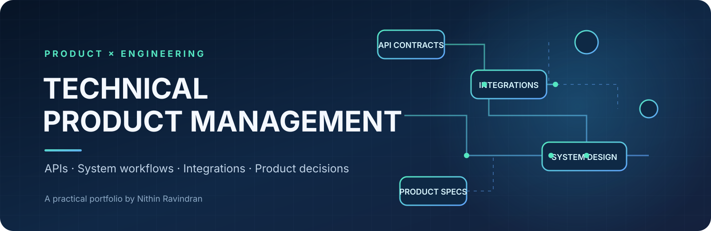
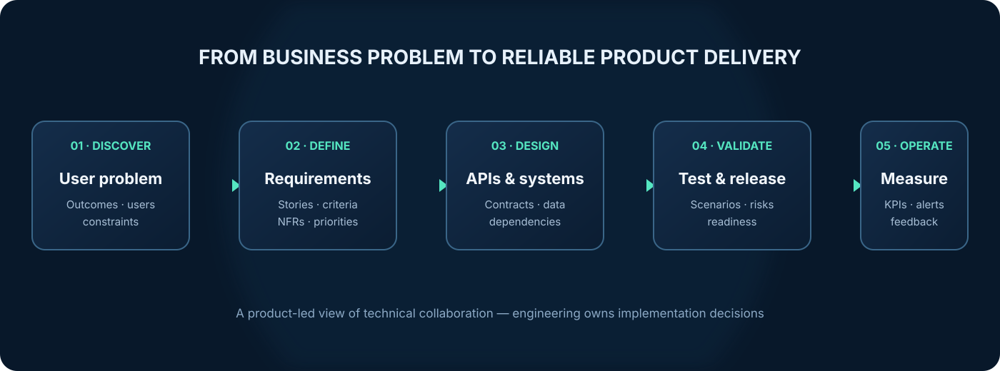

  
   

  
  
  
  

<h1 align="center">Turning business problems into reliable technical products.</h1>

  A hands-on portfolio exploring how product thinking connects with APIs, integrations, system design, technical requirements and delivery.

  <a href="#-explore-the-lab">Explore the lab</a> ·
  <a href="#-featured-case-studies">Case studies</a> ·
  <a href="#-how-i-approach-technical-product-work">My approach</a> ·
  <a href="#-connect">Connect</a>

---

## ✦ What this lab is

Technical Product Management sits at the intersection of **customer needs, business outcomes and engineering execution**.

This repository is a practical showcase of the technical product skills needed to work confidently with engineering, architecture, QA, design and operational teams. It focuses on making complex systems understandable, defining clear product behaviour and anticipating the edge cases that affect real user journeys.

**The goal:** demonstrate product judgement and technical fluency—not pretend that a Product Manager needs to be the system architect or write every line of code.

## ◈ Explore the lab

  

| AREA | WHAT YOU'LL FIND | OPEN |
|---|---|---|
| **01 · API fundamentals** | REST, HTTP methods, status codes, JSON and API literacy | [Explore →](01-api-fundamentals/README.md) |
| **02 · API documentation** | OpenAPI contract, endpoint design and documentation review | [Explore →](02-api-documentation/README.md) |
| **03 · API testing** | Postman collection, environments and positive/negative scenarios | [Explore →](03-postman/README.md) |
| **04 · System design** | Architecture context, sequence diagrams and system boundaries | [Explore →](04-system-design/README.md) |
| **05 · Integrations** | Timeouts, retries, idempotency, webhooks and reconciliation | [Explore →](05-integrations/README.md) |
| **06 · Technical requirements** | User stories, acceptance criteria, NFRs, dependencies and risks | [Explore →](06-technical-requirements/README.md) |
| **07 · Product case studies** | Applied travel and healthcare integration scenarios | [Explore →](07-product-case-studies/README.md) |

## ✧ Featured case studies

<table>
  <tr>
    <td width="50%">
      <h3>✈️ Travel booking API integration</h3>
      
Explore supplier connectivity, price revalidation, booking state transitions, duplicate submission protection and uncertain outcomes.

      
<strong>Focus:</strong> API orchestration · Idempotency · Reconciliation · Booking lifecycle

      <a href="07-product-case-studies/travel-booking-api-integration.md">Read the case study →</a>
    </td>
    <td width="50%">
      <h3>🏥 Healthcare laboratory integration</h3>
      
Explore HIMS–LIS workflows, patient and specimen matching, result exchange, message validation and exception handling.

      
<strong>Focus:</strong> Interoperability · Data integrity · HL7/ASTM context · Auditability

      <a href="07-product-case-studies/healthcare-lab-integration.md">Read the case study →</a>
    </td>
  </tr>
</table>

## ⌘ Practical artefacts

| ARTEFACT | PURPOSE |
|---|---|
| [OpenAPI specification](02-api-documentation/travel-booking-openapi.yaml) | Example contract for booking creation and retrieval |
| [Postman collection](03-postman/booking-api.postman_collection.json) | Importable request examples using a reserved placeholder host |
| [System design diagrams](04-system-design/README.md) | Context and sequence views of a booking workflow |
| [Technical feature brief](06-technical-requirements/README.md) | Scope, user story, Given/When/Then criteria and NFR prompts |

## ◉ How I approach technical product work

1. **Understand the problem** — identify users, pain points, business value and constraints.
2. **Define the behaviour** — clarify scope, workflows, states, edge cases and acceptance criteria.
3. **Map the system** — understand APIs, data ownership, dependencies and integration boundaries with engineering.
4. **Validate the solution** — review contracts, test scenarios, failure handling, security and non-functional needs.
5. **Prepare delivery** — align priorities, dependencies, release readiness and operational ownership.
6. **Learn from outcomes** — use product and operational measures to guide iteration.

## ◇ Tools, concepts & technical vocabulary

Also covered: authentication, authorisation/RBAC, API lifecycle, pagination, versioning, retries, idempotency, observability, auditability, non-functional requirements and Agile product delivery.

## ◌ Portfolio integrity & responsible use

- **Illustrative artefacts:** diagrams, API contracts, requirements and scenarios are constructed to demonstrate product reasoning.
- **Synthetic data:** identifiers and payload examples are fictional; no real customer or patient data is included.
- **Professional context:** domain familiarity reflects areas of work described in my professional background, but the examples are not presented as exact employer implementations.
- **No confidential material:** this repository does not intentionally reproduce proprietary source code, internal architecture or confidential documentation.
- **No unsupported claims:** proposed KPIs are labelled as candidate measures, not results from experiments unless explicitly stated.

Never commit credentials, access tokens, private certificates, production endpoints or personal data. Keep secrets in local environment variables or an approved secret manager.

## ↗ Connect

  
  
  

Built and maintained by <strong>Nithin Ravindran</strong> · Technical Product Management Portfolio

